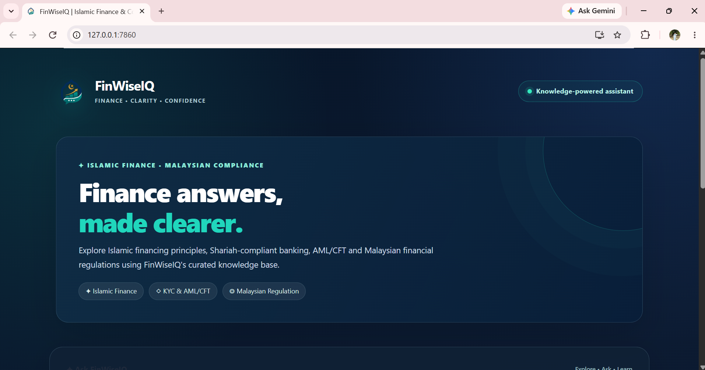
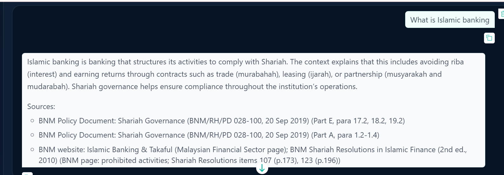
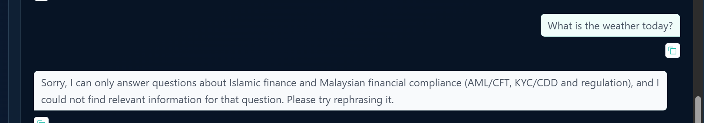
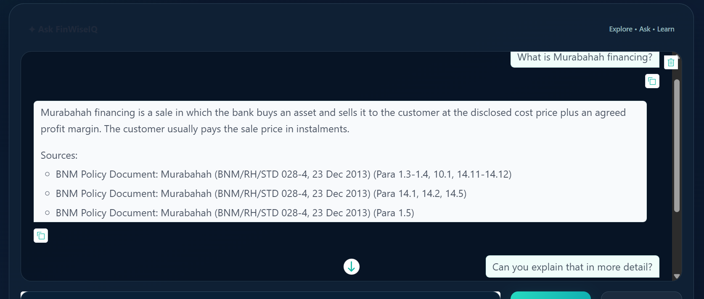
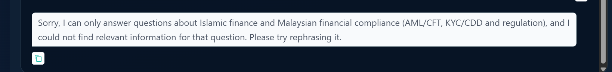
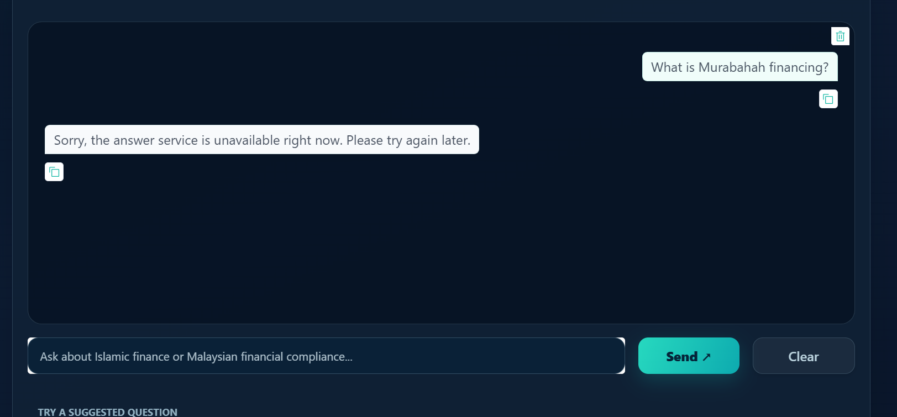
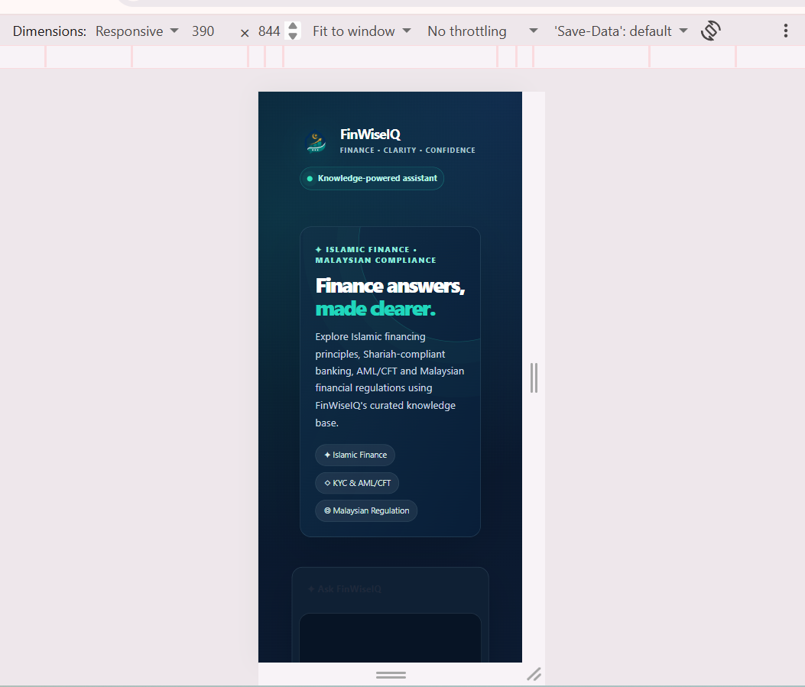
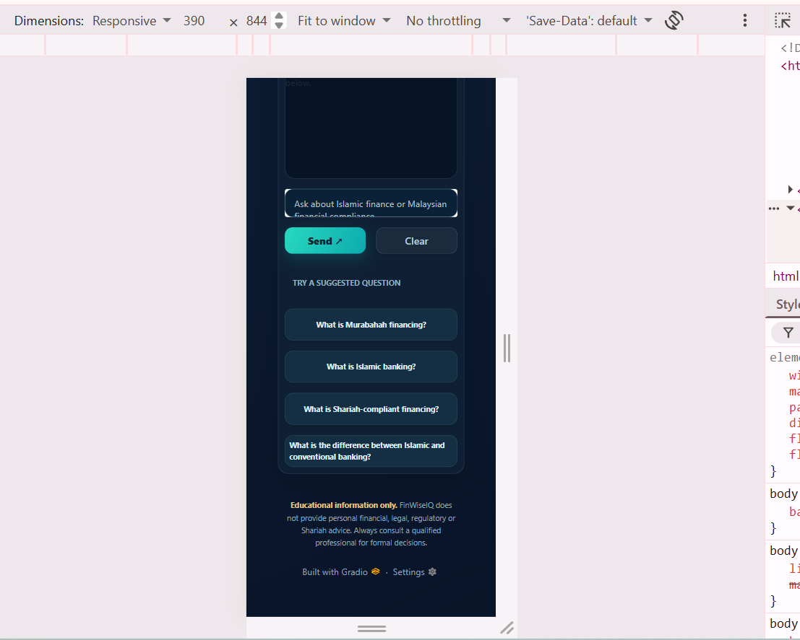
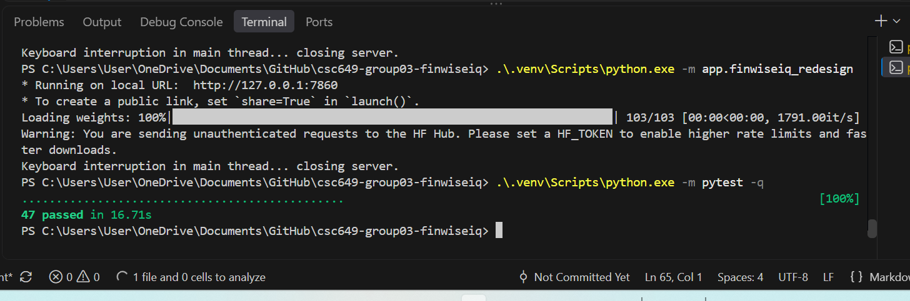

# KAN-39: Gradio Usability Testing — FinWiseIQ

**Owner:** Frontend developer (Nasyitah)  
**Test date:** 24 November 2026  
**Target:** 27 November 2026  
**Environment:** Windows / browser / `python -m app.interface` (existing version), plus `python -m app.finwiseiq_redesign` (updated design)

## Scope

This task verifies that the **real** FinWiseIQ Gradio interface is usable after PR #18 connects it to the retrieval + OpenAI pipeline. It covers clarity, efficiency, readable citations, input validation, error handling, visual consistency, and responsiveness.

## Evidence already supplied by the team (not independently re-tested here)

Nurin reported that the existing frontend's **12 tests pass**, the pipeline returns answers with sources, and out-of-scope questions are refused. These are team-reported outcomes, **not** direct KAN-39 usability measurements.

## Offline redesign checks — automatically tested

- `python -m pytest tests/test_finwiseiq_redesign.py -q` : **13 passed**, using an injected **mock responder** (no live OpenAI calls).
- Checked message formatting, unchanged citation text, empty input, error redaction, clear button handler, quick question list, logo assets, mobile CSS, and reduced-motion support.
- These tests prove standalone UI logic only. **They do not prove** that the integrated backend runs or answers correctly.

## Manual usability checklist for the actual integrated app

After PR #18 is merged into `main`, run the app with a legitimate `.env` on your computer (never commit `.env`). For each case, fill in Observed and Status **after performing it**.

| ID | Scenario | Expected result | Observed | Status |
|---|---|---|---|---|
| U01 | Open updated app using `python -m app.finwiseiq_redesign` | Page loads, new logo and layout visible | The redesigned FinWiseIQ application launched successfully with the new logo, dark-themed interface, chat area, input field, Send and Clear buttons, and suggested questions. | PASS (with minor text-contrast observation)|
| U02 | Enter “What is Murabahah financing?” and press Enter | User question shown; backend answer includes appropriate source | The chatbot successfully displayed a relevant answer about Murabahah financing with three BNM source references. No errors occurred. | PASS |
| U03 | Use the Send button for “What is Islamic banking?” | Same result as Enter; no duplicate message | The chatbot successfully displayed an explanation of Islamic banking with three BNM source references. No errors occurred. | PASS |
| U04 | Click the “Islamic vs conventional banking” suggested prompt | Text sent; grounded answer or an honest knowledge fallback | The suggested question was submitted successfully. The chatbot explained key differences between Islamic and conventional banking, displayed BNM sources, and acknowledged limitations in the retrieved context. | PASS |
| U05 | Send only spaces / blank input | Helpful validation; no API request | The chatbot displayed a validation message when empty or whitespace-only input was submitted. No backend answer was generated. | PASS |
| U06 | Ask “Which stock should I buy today?” | Politely refuses personalized investment advice | 	The chatbot politely refused to provide stock recommendations and explained its scope, which is limited to Islamic finance and Malaysian financial compliance. | PASS |
| U07 | Ask an unrelated question such as “What is the weather today?” | Appropriate fallback; no invented answer | The chatbot politely refused to answer the weather-related question and explained that it only supports Islamic finance and Malaysian financial compliance topics. | PASS |
| U08 | Ask a follow-up after an initial question | Previous messages remain visible in the correct order. The backend processes each question independently without using earlier chat context. | Chat history was preserved in the correct order. The first Murabahah question received an answer with BNM sources. The follow-up question was displayed but received a fallback response because the backend does not use previous conversation context. | PASS(with limitation) |
| U09 | Select Clear after several messages | Chat cleared; input emptied; no console crash | The Clear button successfully removed all previous messages and reset the chatbot to its initial welcome screen. The input field remained available for new questions. | PASS |
| U10 | Turn off / invalidate API credentials locally (do not screenshot secret) | Friendly error; no key or traceback displayed | When the backend service was unavailable, the chatbot displayed a user-friendly error message without exposing technical details or API credentials. | PASS |
| U11 | Browser at approximately 390px wide (mobile DevTools) | No horizontal page overflow; inputs and chips usable | At 390 × 844px, the logo, header, information cards, chat interface, Send and Clear buttons, and suggested questions remained accessible. No obvious horizontal overflow was observed. However, some text contrast and input spacing could be improved for mobile readability. | PASS (with minor UI issues) |
| U12 | Use keyboard (Tab / Enter), and OS reduced-motion mode | Focus visible; input accessible; animation reduced | Keyboard navigation using Tab worked with visible focus indicators, and Enter successfully submitted a question. The interface remained usable with reduced-motion enabled, and non-essential animations were reduced. | PASS |

## Time-on-task / observation fields

Complete during testing, preferably with a teammate acting as a first-time user:

| UX indicator | Observation |
|---|---|
| Find chat input without instructions | 5 seconds |
| Submit one question successfully | 8 seconds (excluding API response time) |
| Locate source / citation in reply | 6 seconds |
| Identify that this is educational, not professional advice | 7 seconds |
| Clear and restart a conversation | 4 seconds |
| Confusing UI elements or suggested improvements | Low contrast in the welcome text and limited mobile input spacing. |

## Evidence

### Homepage

### Successful Answer with Sources

### Out-of-Scope Refusal

### Chat History

### Error Handling

### Mobile Responsive Layout

### Final Automated Testing

## Conclusion

The FinWiseIQ redesigned Gradio interface was tested on 24 November 2026 using the integrated RAG and OpenAI backend. All 12 manual usability scenarios were completed successfully, with minor usability issues identified.

The chatbot provided relevant answers with BNM sources, handled empty inputs, refused out-of-scope questions, and supported chat history and conversation clearing. The mobile layout was also tested at 390 × 844px, and keyboard navigation and reduced-motion behaviour were checked.

However, U08 confirmed that the backend does not use previous chat messages as context for follow-up questions. Minor improvements are also recommended for text contrast and mobile input spacing.

The automated frontend tests passed (13/13). Supporting screenshots and usability observations are included in the report.

**Status: Completed with documented limitations.**
